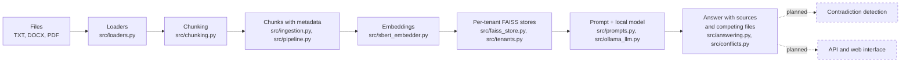

# PolicyLens

PolicyLens is a document question-answering system for organizations. It answers
questions from internal policies, handbooks and circulars using a local language
model, cites the source file and page, and says "I don't know" when the documents
don't support an answer. A metadata-based check for competing documents exists;
detecting real contradictions is planned.

> **Status:** in development. Loading, chunking, per-tenant search, answering through
> a local model, a first check for competing documents and a command-line tool work
> and are tested. Contradiction detection, an API and a web interface are planned.

## Problem

Company rules are spread across many documents, and those documents often
disagree (for example, a 30-day and a 15-day return policy). People waste time
searching, and they can act on outdated or conflicting information.

## What works today

- **File loading:** reads TXT, DOCX and PDF files, keeping page numbers for PDFs.
- **Chunking:** splits text into overlapping chunks (200 words, 40 overlap by default).
- **Metadata:** each chunk carries its source file, page, document type, version
  and date. Files loaded through the command line get the file's modified date.
- **Semantic search:** chunks are embedded with a MiniLM model and searched with
  FAISS. A `min_score` cutoff drops chunks that are not similar enough.
- **Tenant isolation:** each tenant has its own store. A test checks that one
  tenant never retrieves another tenant's text.
- **Answering:** a numbered prompt is sent to a local model through Ollama, and the
  answer is returned with the retrieved sources. If nothing passes the cutoff, the
  system returns "I don't know." without calling the model.
- **Competing sources:** when retrieved chunks come from different files of the same
  document type, the answer lists those files newest first, and the prompt marks the
  newest source and tells the model to prefer it and say that an older source differs.
  This uses metadata only. It does not check whether the texts really disagree.
- **Command line:** `scripts/ask.py` loads any files you name for a tenant and
  answers a question about them.
- **Evaluation script:** compares similarity cutoffs on a small set of labelled
  questions.
- **Configuration and logging:** validated settings; every log line includes a
  tenant ID.
- **Quality checks:** 49 pytest tests, ruff linting, and pre-commit hooks that block
  committed secrets and `.env` files.
- **Docker:** a Dockerfile is included (not yet built and tested end to end).

## Evaluation (small samples)

**Similarity cutoff.** On 11 labelled questions over a six-sentence sample file (7
answerable, 4 unrelated), with only the top chunk counted:

| Cutoff | Answerable found | Unrelated refused |
|---|---|---|
| none | 7/7 | 0/4 |
| 0.15 | 7/7 | 4/4 |
| 0.30 | 6/7 | 4/4 |
| 0.50 | 5/7 | 4/4 |

This sample is far too small to prove a good cutoff for real documents. 0.15 is a
starting value to re-test on real files. Run it with
`python -m scripts.eval_cutoffs`.

**Competing documents.** Two one-sentence return policies, a 2025 version (30 days)
and a 2026 version (15 days), and the question "How many days do I have to return an
item?", asked five times with `llama3.2:3b` through `scripts/ask.py`:

| Prompt | Correct (15 days) | Wrong (30 days) | Refused |
|---|---|---|---|
| Version and date shown, no label | 2 | 2 | 1 |
| Newest source labelled | 5 | 0 | 0 |

With the label, four of the five answers also said that an older source differs.
This is one question on two tiny files, and a small local model varies from run to
run, so it shows an improvement, not a guarantee.

## Planned

1. Detecting real contradictions between documents (the current check uses metadata
   only), and preferring the authoritative one
2. Checking that the sources a model cites are real, and showing only those
3. Evaluation on real documents with a larger labelled set
4. API and a simple web interface with document upload

## Architecture



Solid boxes are built; dashed boxes are planned.

## Getting started

Requires Python 3.11, Git, and [Ollama](https://ollama.com) for answering.

```powershell
git clone https://github.com/Laiba-Qayyum/policylens.git
cd policylens
python -m venv .venv
.\.venv\Scripts\Activate.ps1
pip install -r requirements-dev.txt
pytest
```

To ask a question about your own files (the first run downloads the embedding
model):

```powershell
ollama pull llama3.2:3b
python -m scripts.ask --tenant acme --file samples/hr_policy.txt --question "How many days of annual leave do I get?"
```

Repeat `--file` to load several files. If they look like competing versions of the
same document, the output ends with a note listing them, newest first.

## Project structure

| Path | Purpose |
|---|---|
| `src/config.py` | Validated settings |
| `src/log.py` | Logging with tenant ID |
| `src/loaders.py` | TXT, DOCX and PDF loading |
| `src/chunking.py` | Overlapping text chunks |
| `src/ingestion.py` | Chunks with metadata |
| `src/pipeline.py` | Loads files into a tenant's store |
| `src/embeddings.py`, `src/sbert_embedder.py` | Embedder interface and MiniLM implementation |
| `src/vector_store.py`, `src/faiss_store.py` | Store interface and FAISS implementation |
| `src/tenants.py` | One store per tenant |
| `src/conflicts.py` | Finds files that may compete (same type, different date) |
| `src/prompts.py` | Builds the numbered prompt |
| `src/llm.py`, `src/ollama_llm.py` | Model interface and Ollama client |
| `src/answering.py` | Question to answer with sources |
| `src/cli.py` | Command-line options |
| `src/evaluation.py` | Scores retrieval on labelled questions |
| `scripts/ask.py` | Ask a question about your files |
| `scripts/` (other) | Demos and the cutoff evaluation |
| `tests/` | pytest tests |
| `docs/decisions/` | Decision records |
| `PROBLEMS.md` | Problems encountered and how they were fixed |

## Development

Built with AI assistance (Claude) as a guide and reviewer, following a 10-day plan.
I write and run the code step by step, writing the test first, and I check results
against real test and script output. The problems I hit and how I fixed them are in
`PROBLEMS.md`.

## Limitations

- Refusal depends partly on the model following the "I don't know" instruction.
- All retrieved chunks are listed as sources, not only the ones the model cited, and
  citations in the reply are not yet checked.
- The cutoff of 0.15 comes from a very small sample and may not suit real documents.
- The competing-source check uses metadata only, so two unrelated files of the same
  type are also flagged.
- Preferring the newest source depends on the model. The label made it reliable in
  five runs on one tiny example, but a small local model can still get it wrong.
- Files loaded from the command line get the default type "policy", version "1.0" and
  the file's modified date. A missing file is not handled gracefully yet.
- Needs a local Ollama server and model to answer.
- No real contradiction detection, API or web interface yet.
- The design stores search indexes in memory on one machine, so it suits a single
  server, not thousands of customers. A larger deployment would need a
  database-backed store, background workers and load testing.