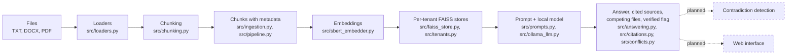

# PolicyLens

PolicyLens is a document question-answering system for organizations. It answers
questions from internal policies, handbooks and circulars using a local language
model, cites the source file and page, and says "I don't know" when the documents
don't support an answer. It flags documents that may compete (same type, different
date) and prefers the newest. Detecting real contradictions is planned.

> **Status:** in development. Loading, chunking, per-tenant search, answering through
> a local model, citation checking, a first check for competing documents, a
> command-line tool and a small HTTP API work and are tested. Contradiction
> detection, testing on real documents and a web interface are planned.

## Problem

Company rules are spread across many documents, and those documents often
disagree (for example, a 30-day and a 15-day return policy). People waste time
searching, and they can act on outdated or conflicting information.

## What works today

- **File loading:** reads TXT, DOCX and PDF files, keeping page numbers for PDFs.
- **Chunking:** splits text into overlapping chunks (200 words, 40 overlap by default).
- **Metadata:** each chunk carries its source file, page, document type, version
  and date. Files loaded through the command line or the API get type "policy" and
  version "1.0". The date is the file's modified time unless you give one (see below).
- **Semantic search:** chunks are embedded with a MiniLM model and searched with
  FAISS. A `min_score` cutoff drops chunks that are not similar enough.
- **Tenant isolation:** each tenant has its own store. Tests check that one tenant
  never retrieves another tenant's text, including through the API.
- **Answering:** a numbered prompt is sent to a local model through Ollama. If nothing
  passes the cutoff, the system returns "I don't know." without calling the model.
- **Citation check:** the sources returned are the ones the reply cites like `[1]`.
  If the reply cites nothing, or cites a number that doesn't exist, the answer is
  returned marked `verified: false` and all retrieved sources are kept.
- **Competing sources:** when retrieved chunks come from different files of the same
  document type, the answer lists those files newest first, and the prompt marks the
  newest source and tells the model to prefer it and say that an older source differs.
  This uses metadata only. It does not check whether the texts really disagree.
- **Command line:** `scripts/ask.py` loads the files you name for a tenant and answers
  a question. `--file path@2025-01-01` sets a file's document date.
- **HTTP API:** `POST /tenants/{tenant_id}/documents` uploads files for a tenant and
  `POST /tenants/{tenant_id}/ask` answers a question, returning the answer, sources,
  competing files and the `verified` flag. An upload is all-or-nothing, and an
  unsupported file type returns a 400 error and adds nothing.
- **Evaluation script:** compares similarity cutoffs on a small set of labelled
  questions.
- **Configuration and logging:** validated settings; every log line includes a
  tenant ID.
- **Quality checks:** 67 pytest tests, ruff linting, and pre-commit hooks that block
  committed secrets and `.env` files.
- **Docker:** a Dockerfile is included (not yet built and tested end to end).

## Evaluation (small samples)

**Similarity cutoff.** On 11 labelled questions over a six-sentence sample file (7
answerable, 4 unrelated), with only the top chunk counted:

| Cutoff | Answerable found | Unrelated refused |
|---|---|---|
| none | 7/7 | 0/4 |
| 0.15 | 7/7 | 4/4 |
| 0.30 | 6/7 | 4/4 |
| 0.50 | 5/7 | 4/4 |

This sample is far too small to prove a good cutoff for real documents. 0.15 is a
starting value to re-test on real files. Run it with
`python -m scripts.eval_cutoffs`.

**Competing documents.** Two one-sentence return policies (30 days and 15 days) and
the question "How many days do I have to return an item?", asked five times per
setting with `llama3.2:3b` through `scripts/ask.py`, with explicit document dates:

| Which file is newest | Right answer by the newest-date rule | Answers following it |
|---|---|---|
| The 15-day policy (2026) | 15 days | 5 of 5 |
| The 30-day policy (dates swapped) | 30 days | 5 of 5 |

In the swapped setting, one reply cited no source and was flagged unverified. The
15-day file was listed first in both settings, so the answers followed the date label,
not the position. This is one question on two tiny files, and a small local model
varies from run to run, so it shows the idea works, not that it is reliable. An
earlier comparison was withdrawn because both files had the same file-modified date.

**API check.** Against a real running server, uploading `samples/hr_policy.txt` for
tenant `acme` and asking about annual leave gave a correct answer with its source.
A parking question and the same leave question for a tenant with no documents both
returned "I don't know." This was checked by hand, not by an automated test with the
real model.

## Planned

1. Detecting real contradictions between documents (the current check uses metadata
   only), and preferring the authoritative one
2. Checking that a cited source actually supports the claim (today only its existence
   is checked)
3. Testing on real documents with a larger labelled set
4. Date and version fields in the upload API
5. A simple web interface
6. Persistence, authentication, and a built and tested Docker image

## Architecture



Solid boxes are built; dashed boxes are planned. The HTTP API (`src/api.py`) wraps
the upload and answering steps, and `src/main.py` runs it with the real components.

## Getting started

Requires Python 3.11, Git, and [Ollama](https://ollama.com) for answering.

```powershell
git clone https://github.com/Laiba-Qayyum/policylens.git
cd policylens
python -m venv .venv
.\.venv\Scripts\Activate.ps1
pip install -r requirements-dev.txt
pytest
```

**Ask from the command line** (the first run downloads the embedding model):

```powershell
ollama pull llama3.2:3b
python -m scripts.ask --tenant acme --file samples/hr_policy.txt --question "How many days of annual leave do I get?"
```

Repeat `--file` to load several files, and add `@YYYY-MM-DD` to give a file its real
document date:

```powershell
python -m scripts.ask --tenant acme --file samples/returns_2025.txt@2025-01-01 --file samples/returns_2026.txt@2026-01-01 --question "How many days do I have to return an item?"
```

If the files look like competing versions of the same document, the output ends with a
note listing them, newest first. If the reply cites no valid source, it prints a
warning.

**Run the API.** Start the server in one terminal and leave it running:

```powershell
uvicorn src.main:app
```

In a second terminal, upload a file and ask a question:

```powershell
curl.exe -F "files=@samples/hr_policy.txt" http://127.0.0.1:8000/tenants/acme/documents
$body = '{"question": "How many days of annual leave do I get?"}'
Invoke-RestMethod -Method Post -Uri http://127.0.0.1:8000/tenants/acme/ask -ContentType "application/json" -Body $body
```

The interactive page at `http://127.0.0.1:8000/docs` works for asking questions, but
its file picker did not send files correctly in testing, so use `curl.exe` to upload.

## Project structure

| Path | Purpose |
|---|---|
| `src/config.py` | Validated settings |
| `src/log.py` | Logging with tenant ID |
| `src/loaders.py` | TXT, DOCX and PDF loading |
| `src/chunking.py` | Overlapping text chunks |
| `src/ingestion.py` | Chunks with metadata |
| `src/pipeline.py` | Loads files into a tenant's store, all-or-nothing, with optional dates |
| `src/embeddings.py`, `src/sbert_embedder.py` | Embedder interface and MiniLM implementation |
| `src/vector_store.py`, `src/faiss_store.py` | Store interface and FAISS implementation |
| `src/tenants.py` | One store per tenant |
| `src/conflicts.py` | Finds files that may compete (same type, different date) |
| `src/citations.py` | Finds which sources a reply cites and which citations are invalid |
| `src/prompts.py` | Builds the numbered prompt |
| `src/llm.py`, `src/ollama_llm.py` | Model interface and Ollama client |
| `src/answering.py` | Question to answer with sources |
| `src/cli.py` | Command-line options |
| `src/api.py` | HTTP endpoints for upload and ask |
| `src/main.py` | Runs the API with the real components |
| `src/evaluation.py` | Scores retrieval on labelled questions |
| `scripts/ask.py` | Ask a question about your files |
| `scripts/` (other) | Demos and the cutoff evaluation |
| `tests/` | pytest tests |
| `docs/decisions/` | Decision records |
| `PROBLEMS.md` | Problems encountered and how they were fixed |

## Development

Built with AI assistance (Claude) as a guide and reviewer, following a 10-day plan.
I write and run the code step by step, writing the test first, and I check results
against real test and script output. The problems I hit and how I fixed them are in
`PROBLEMS.md`.

## Limitations

- Refusal depends partly on the model following the "I don't know" instruction.
- `verified` means the reply cites a source that exists, not that the source supports
  the claim. A reply can cite the wrong file and still count as verified.
- The cutoff of 0.15 comes from a very small sample and may not suit real documents.
- The competing-source check uses metadata only, so two unrelated files of the same
  type are also flagged.
- Preferring the newest source depends on the model. It followed the date label in
  five runs per setting on one tiny example, but a small local model can still get it
  wrong.
- Document dates come from the file's modified time unless you pass `--file path@date`.
  The API has no date field yet, so uploaded files get their upload time. The type and
  version are fixed defaults.
- The API has no authentication: any caller who can reach it can name any tenant.
- Documents are stored in memory, so restarting the server loses everything that
  was uploaded.
- Only the happy path and unsupported file types are handled. A corrupt PDF or DOCX
  is not handled gracefully yet.
- Everything was tested on tiny sample files, not on real documents yet.
- Needs a local Ollama server and model to answer.
- The design stores search indexes in memory on one machine, so it suits a single
  server, not thousands of customers. A larger deployment would need a
  database-backed store, background workers and load testing.